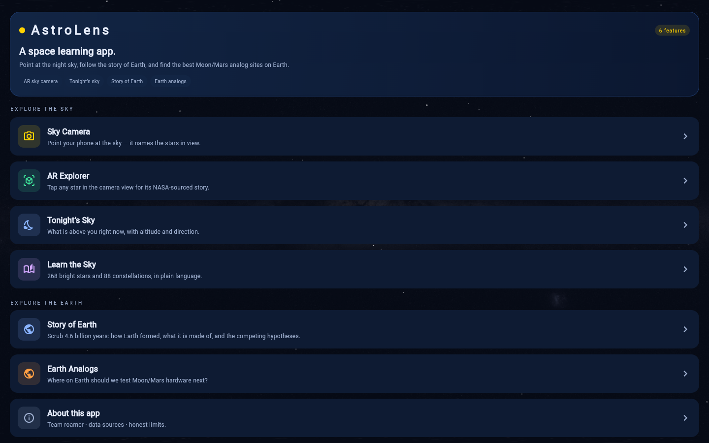
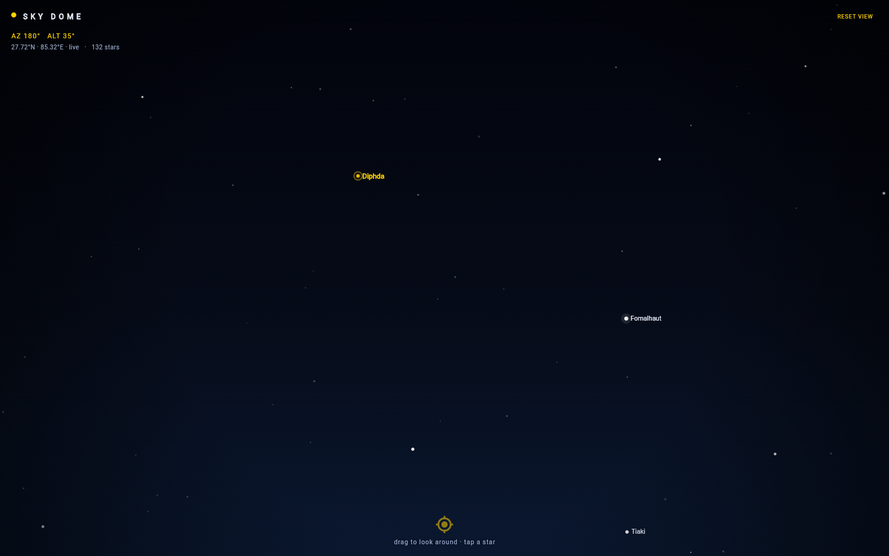
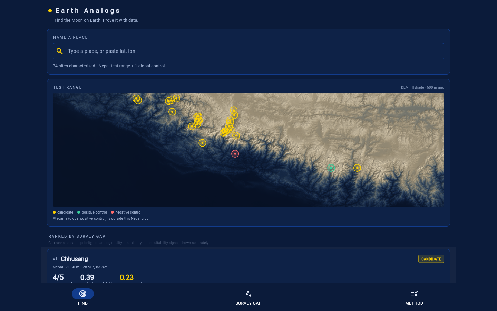
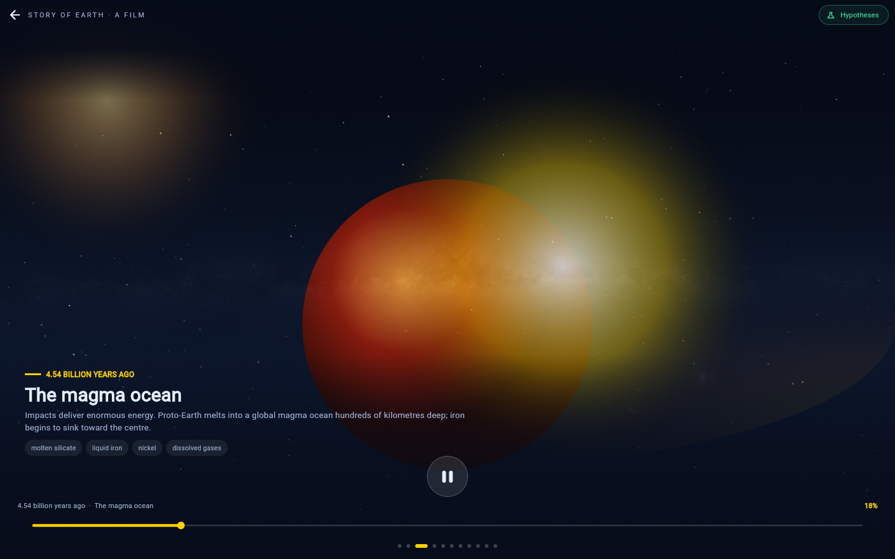

# AstroLens — a space learning app

**Team roamer · NASA Space Apps Challenge 2026 (Bhaktapur, Virtual)**

Point at the night sky and name the stars. Scrub 4.6 billion years of Earth's formation. Then use the **Earth Analogs** engine to answer our challenge — *Identify Earth Locations that Analog the Permanent Moon Base Locations and Mars*.

**Live:** https://sushant-me.github.io/roamer/ · **APK:** [latest release](https://github.com/sushant-me/roamer/releases/latest/download/app-release.apk) · **29 s demo:** [video](https://sushant-me.github.io/roamer/video/roamer_demo_30s.mp4)



## Six features

| Feature | What it does |
|---|---|
| **AR Sky Camera** | Uses the phone camera and motion sensors to estimate where it points, then names the nearest bright stars. Manual aim fallback when sensors are unavailable. |
| **AR Explorer · Sky Dome** | Tap a star for its story; drag a 360° dome built from a 268-star catalogue. |
| **Tonight's Sky** | Everything above your location right now, with altitude and direction. |
| **Learn the Sky** | 268 bright stars and all 88 IAU constellations, with plain-language stories. |
| **Story of Earth** | A 4.6-billion-year timeline, a playable film, whole-Earth composition, and five competing formation hypotheses. |
| **Earth Analogs** | The challenge engine: 34 sites scored on one 500 m grid, a quantified mismatch ledger, and a survey-gap ranking. |



## The challenge answer — Earth Analogs

- **Survey Gap = similarity × (1 − literature attention) × operability** — a research-priority signal, not a certification of base-site suitability.
- **Chhusang** leads (similarity 0.39, attention 0.26, gap **0.23**, proxy range 0.23–0.31); **Kagbeni** second (5/5 checks, gap 0.16, range 0.00–0.16).
- **Controls:** Atacama passes 5/5 but scores 0.00 — already studied. Pokhara fails aridity and scores 0.00.
- **Stability:** weights ±20% → top unchanged 10/10; thresholds ±20% → 16 pass/fail labels move, ranking unchanged by construction.
- Seven international analogs are similarity-screened; with a second literature index their proxy gap is ≈0.00 (Askja 0.07) — well studied, like Atacama.



## Story of Earth

A slider and a 75-second animated film walk from the solar nebula to today: planetesimals, magma ocean, Moon-forming impact, core and magnetic field, oceans, late accretion, continents, the Great Oxidation, complex life. Each stage lists materials and evidence. A Hypotheses tab plays the debate between core accretion, disk instability, giant impact, late veneer and water delivery — with the evidence and the open problem for each.



## Data & provenance

- Star positions/magnitudes: **HYG Database v4.1** (astronexus/HYG-Database, CC BY-SA 4.0); descriptions written for this app.
- Imagery: NASA Images API and NASA/ESO public images (Blue Marble — Apollo 17; Milky Way panorama — ESO/S. Guisard; nebulae and ISS night pass).
- Earth analogs: AWS Terrain Tiles (Terrarium, SRTM-derived) at 500 m, Open-Meteo ERA5 2015–2024, ERA5-Land soil 6 cm, NASA POWER MERRA-2 skin temperature (context), OpenAlex literature counts, NASA PDS MOLA/THEMIS ranges.
- Every number is traceable in the app.

## Honest limits

- The Earth-analog set is a **regional shortlist** (Nepal + Atacama), not a global survey.
- SRTM gives elevation only — no geology or regolith. ERA5/MERRA-2 are coarse (500 m grid vs ~9/50 km). No MODIS skin temperature yet.
- Star pointing uses a low-precision sidereal-time model (fraction-of-a-degree error) and depends on device sensors; manual aim is the fallback. This is a learning tool, not a planetarium-grade ephemeris.
- Operability for analog sites is an analyst-assigned judgment.

## Reviews

- **Human methodology review**: Arun Lohar (@arunlohar11), Space Apps Connect #2115 — resolved and credited; threshold and proxy sensitivity, suitability-vs-priority framing and data limits were incorporated.
- **ChatGPT judge review**: 20 → 23 → **24/25** across four passes.

## Run / build

```sh
flutter pub get
flutter run -d chrome          # or a device
flutter test
flutter build web --release --base-href /roamer/
flutter build apk --release
```

The data pipeline (Node, optional) lives in `tools/`: `build_data.js` regenerates the analog dataset, `stars.json` is the HYG-derived star catalogue, `constellations.json` the IAU list.

## Credits

Team roamer · NASA Space Apps 2026. MIT licensed. Star catalogue CC BY-SA 4.0 (HYG); NASA/ESO images retain their respective credits.
